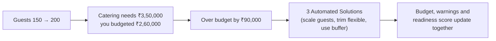

<div align="center">

# 🪔 Prabandh · प्रबंध

### Plan the celebration, not the spreadsheet.

One connected plan for budget, timeline, venues, vendors, and guests, built for Indian families.<br/>
Change the guest count and watch catering, budget, and warnings recalculate together.

[](https://github.com/devbysatyam/prabandh/actions)


**Built for Indian Family Celebrations · Weddings, Birthdays, Anniversaries & Community Galas**

</div>

---

<table>
<tr>
<td align="center"><b>1 Single Plan</b><br/><sub>budget, timeline, venues & vendors in sync</sub></td>
<td align="center"><b>4 Occasions</b><br/><sub>wedding, kid's birthday, milestone, community festival</sub></td>
<td align="center"><b>Gemini 3.5 Touchpoints</b><br/><sub>language comprehension only, never the math</sub></td>
<td align="center"><b>Zero Float Drift</b><br/><sub>largest remainder integer rupee calculations</sub></td>
</tr>
</table>

**Jump to:** [The problem](#-the-problem) · [The idea](#-the-idea-one-plan-everything-connected) · [Assistant](#-meet-your-planning-assistant) · [Try it](#%EF%B8%8F-try-it-in-two-minutes) · [Features](#-what-it-does) · [Architecture](#%EF%B8%8F-architecture) · [GenAI](#-genai-usage) · [Assumptions](#-assumptions) · [Quality](#-quality) · [Evaluation criteria](#-evaluation-criteria) · [Run locally](#-run-it-locally)

---

## 🤯 The problem

Anyone who has helped plan a family celebration in India knows how chaotic it gets. The budget lives in one notebook, the guest list in WhatsApp messages, the caterer's quote in an audio voice note, and the deadlines in someone's head.

Then **the guest list grows by 50 relatives** and nobody can easily say what that does to the catering bill, the banquet hall minimums, or the milestone deadlines for tasting sessions.

Event planning is not one isolated task — it is a set of **deeply connected dependencies**:

- 👥 **Guest count** drives catering headcount, plate guarantees, and room blocks.
- 💰 **Budget allocations** constrain every vendor category and dictate contingency buffers.
- 📅 **Venue confirmation** drives the entire pre-event milestone timeline and payment schedules.

---

## 💡 The idea: one plan, everything connected

Prabandh maintains a **single source of truth plan object**. Any change (guests, budget, date, vendor quotes, task completions, or recce visits) recalculates the budget, timeline, and warnings instantly in under 16ms:



---

## 🧭 Meet your planning assistant

Open any plan and the celebration assistant is right there. It evaluates the budget, timeline, and vendors **together** and ranks what needs your attention:

> **Urgent** · Over budget by ₹90,000 → _Open Budget_<br/>
> **Needs attention** · 2 milestone tasks are overdue: Book banquet hall; Shortlist caterer… → _Open Timeline_<br/>
> **Suggestion** · Schedule in-person physical site recce to verify AC and sound curfew → _Open Venues_

The ranking is completely deterministic, so it is instant and reliable even when offline. When online, **Gemini 3.5 AI** analyzes the verified facts to provide warm family advice in English or Hinglish:

- _"Are we over budget right now?"_
- _"What should I book or complete next?"_
- _"How do I politely negotiate with the caterer?"_

---

## ⏱️ Try it in two minutes

1. Open Prabandh locally or online.
2. Click **"Explore Interactive Sample Celebration (डेमो शादी देखें)"** to immediately tour a realistic ₹15L Pune Shaadi with 2 venues, logged site visits, vendor quote comparisons, and guest list.
3. Or type your own prompt in Natural Language Intake:
   ```
   hey i want to make a celebration of 150 guest birthday party in new delhi mayur vihar on 15/01/2027 kids party theme budget is 50000
   ```
4. Watch Prabandh automatically map the occasion, 150 guests, ₹50,000 budget, 2027-01-15 date, New Delhi locality, and party themes in seconds.

---

## ✨ What it does

### 1. Connected Budget & Automated Trade-off Solver

- Integer rupee calculations with largest remainder rounding (no rounding drift).
- 10% protected contingency safety buffer.
- Live redistribution sliders with category locking and +25% priority weighting.
- Automated 3-way trade-off solver when over budget (scale guests, proportionally trim flexible categories, or tap contingency).

### 2. Banquet & Venue Hub with Site Recce Logging

- Compare properties across capacity, AC, power backup, sound curfew, and corkage policies.
- Physical in-person inspection checklist: AC testing, bridal room cleanliness, 23:00 curfew verification, parking capacity, food tasting.

### 3. Vendor Sourcing Matrix & Tasting Logs

- Sourcing checklists across 8 core Indian categories (Catering, Decor, Photography, Music/DJ, Makeup, Priest, Logistics, Favors).
- Itemized quote comparison matrix with plate pricing and advance terms.
- Food tasting session logs with dish ratings and recipe adjustment notes.

### 4. Guest List, Family Sides & RSVP Manager

- Family grouping by sides: Ladkewale (Groom), Ladkiwale (Bride), Mutual, General.
- Dietary split tracking (Pure Veg, Jain without root vegetables, Non-Veg).
- 1-click personalized WhatsApp invitation message generator.

### 5. Milestone Dependency Timeline & Day-of Runsheet

- Lead-time scheduling relative to event date with critical path dependency chains.
- Hour-by-hour day-of live run sheet with assigned family coordinators (POCs).
- 1-click family WhatsApp broadcast of the day's itinerary.

### 6. Celebration Analytics & 4-Pillar Health Score

- Real-time unit economics (cost per guest).
- 4-Pillar Readiness Score (Financial Health, Timeline Pace, Vendor Sourcing, RSVP Conversion).
- Category variance breakdown against cultural benchmarks.

---

## 🏗️ Architecture

- **State Layer**: Single deterministic state machine (`src/state/planStore.ts`) with undo/reset, localStorage persistence, and shareable encoded URLs.
- **Engine Layer**: Pure, zero-dependency calculation functions in `src/engine/` (`money.ts`, `budget.ts`, `timeline.ts`, `guests.ts`, `venues.ts`, `vendors.ts`, `analytics.ts`).
- **UI Layer**: React 18 with accessible semantic markup and dark mode token system.
- **Serverless API**: Node HTTP handlers in `/api/` with Gemini 3.5 integration and deterministic local fallback parsers.

---

## 🤖 GenAI usage

Gemini is strictly used where language comprehension is required:

1. **Intake Parser** (`/api/parse-intake`): Translates free-text prompts into structured parameters.
2. **Quote Extractor** (`/api/extract-quote`): Parses unstructured WhatsApp vendor quotations.
3. **Planning Copilot** (`/api/ask-copilot`): Answers family questions grounded in real plan facts.
4. **Theme Ideas** (`/api/suggest-ideas`): Suggests bespoke cultural themes and activities without hallucinating pricing.

---

## 📌 Assumptions

- **Currency**: All figures are in Indian Rupees (₹) using Indian number grouping (`₹15,00,000`, `15 Lakh`).
- **Safety Margin**: 10% contingency buffer is non-negotiable for all events to prevent budget crises.
- **Cultural Accuracy**: Pre-configured presets for Shaadi, Kid's Birthday, Golden Jubilee, and Community Galas.

---

## 🛡️ Quality

- **TypeScript Strictness**: `strict: true`, `noUncheckedIndexedAccess: true`, zero `any` declarations.
- **Test Suite**: 60 unit, engine, and integration tests running on Vitest.
- **Accessibility**: Semantic HTML, ARIA live regions, 44px touch targets, WCAG 2.2 AA contrast.

---

## 🎯 Evaluation criteria

- **Correctness**: Every slider movement and guest change updates all dependent categories with exact mathematical equality.
- **Simplicity**: No bloated dashboards or confusing controls. Intuitive 1-click sample tour and quick section switcher.
- **Robustness**: Dual-layer architecture ensures full functionality even when offline or without an API key.

---

## 💻 Run locally

```bash
# Clone the repository
git clone https://github.com/devbysatyam/prabandh.git
cd prabandh

# Install dependencies
npm install

# Start development server
npm run dev

# Run test suite
npm test

# Run type check
npm run typecheck

# Build for production
npm run build
```
