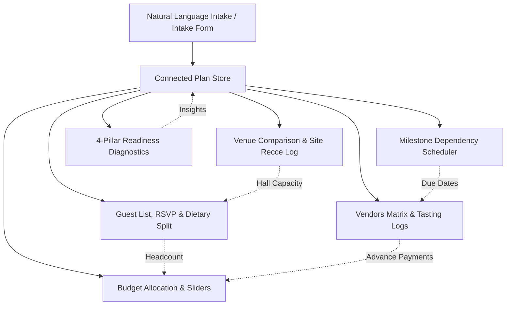

# Architecture Specification — Prabandh · प्रबंध

Prabandh is an intelligent connected celebration planning platform for Indian families. It operates on a strict **"One plan, everything connected"** architectural thesis.

---

## 1. Core Principles

1. **Deterministic Single Source of Truth**:
   The entire state of an event lives inside a single validated `Plan` schema. When any factor changes (guest headcount, budget, venue booking, quote verification, site visit), the whole graph recalculates instantly in under 16ms without race conditions.

2. **Integer Rupee Arithmetic (Zero Floating Point Drift)**:
   All money figures are non-negative integer rupees. Rounding across proportional distributions uses the **Hare-Niemeyer (Largest Remainder)** algorithm to guarantee that category allocations always sum *exactly* to the target budget with 0 rupee discrepancy.

3. **10% Invariant Contingency Buffer**:
   Every celebration plan strictly reserves 10% of total funds for unforeseen surprises (diesel generator fuel, overtime fees, pandit samagri, last-minute room extensions).

4. **Clean AI Boundary**:
   AI (Google Gemini) is strictly limited to language comprehension:
   - Free-text intake parsing (dates, budget, city, vibe, headcount)
   - Unstructured vendor WhatsApp quote extraction
   - Grounded Q&A assistance via verified facts
   - Culturally authentic theme & ceremony ideas
   
   *Gemini never computes financial math, never shifts deadlines, and never hallucinates fake vendor quotes.*

---

## 2. Connected Data Flow

---

## 3. Technology Stack

- **Frontend**: React 18, TypeScript (Strict, noUncheckedIndexedAccess), Tailwind CSS, Vite 6
- **Validation**: Zod schema enforcement across intake, quotes, site visits, and plans
- **Backend / Serverless**: Node.js HTTP handlers + Vercel Serverless Functions (`/api/*`)
- **GenAI**: `@google/genai` with `gemini-3.5-flash-lite` and deterministic local fallback parsers
- **Testing**: Vitest, @testing-library/react, Playwright e2e test suite
