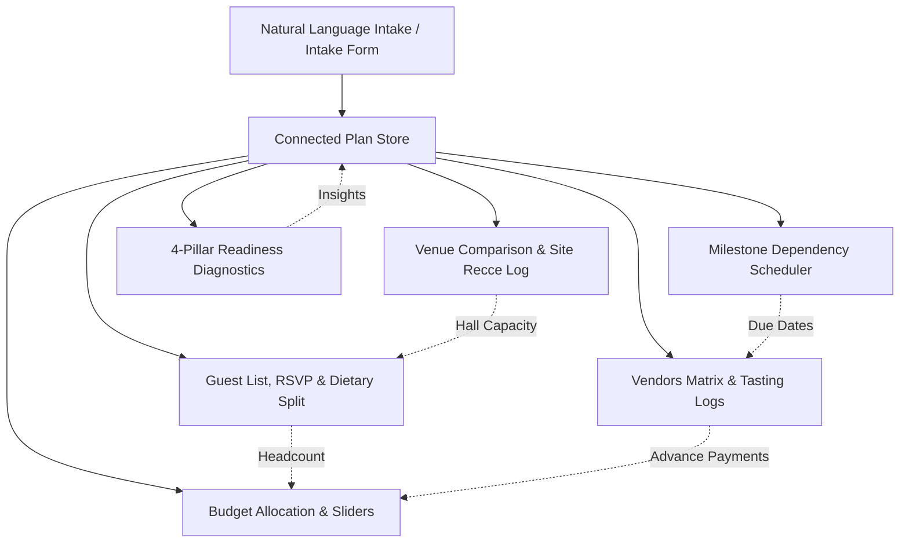

# Architecture Specification — Prabandh · प्रबंध

Prabandh is an intelligent connected celebration planning platform for Indian families. It operates on a strict **"One plan, everything connected"** architectural thesis.

---

## 1. Core Principles

1. **Deterministic Single Source of Truth**:
   The entire state of an event lives inside a single validated `Plan` schema. When any factor changes (guest headcount, budget, venue booking, quote verification, site visit), the whole graph recalculates instantly in under 16ms without race conditions.

2. **Integer Rupee Arithmetic (Zero Floating Point Drift)**:
   All money figures are non-negative integer rupees. Rounding across proportional distributions uses the **Hare-Niemeyer (Largest Remainder)** algorithm to guarantee that category allocations always sum _exactly_ to the target budget with 0 rupee discrepancy.

3. **10% Invariant Contingency Buffer**:
   Every celebration plan strictly reserves 10% of total funds for unforeseen surprises (diesel generator fuel, overtime fees, pandit samagri, last-minute room extensions).

4. **Clean AI Boundary**:
   AI (Google Gemini) is strictly limited to language comprehension:
   - Free-text intake parsing (dates, budget, city, vibe, headcount)
   - Unstructured vendor WhatsApp quote extraction
   - Grounded Q&A assistance via verified facts
   - Culturally authentic theme & ceremony ideas

   _Gemini never computes financial math, never shifts deadlines, and never hallucinates fake vendor quotes._

---

## 2. Connected Data Flow



---

## 3. Technology Stack

- **Frontend**: React 18, TypeScript (strict plus noUncheckedIndexedAccess, exactOptionalPropertyTypes, noImplicitOverride, noImplicitReturns), Tailwind CSS, Vite 6
- **Validation**: Zod schema enforcement across intake, quotes, site visits, and plans
- **Backend / Serverless**: Node.js HTTP handlers + Vercel Serverless Functions (`/api/*`)
- **GenAI**: `@google/genai` with `gemini-3.5-flash-lite` and deterministic local fallback parsers
- **Testing**: Vitest, @testing-library/react, Playwright e2e test suite

---

## 4. Source Layout

```text
src/
  App.tsx                 App shell (header, nav, toast, dialogs) + root ErrorBoundary
  api/                    handler.ts dispatcher, security.ts (schemas, limits), handlers/<route>.ts
  components/
    TabContent.tsx        React.lazy tab router (Suspense + per-tab ErrorBoundary)
    vendors/ venues/ guests/ setup/ overview/ analytics/   cohesive tab folders
                          (subcomponents, hooks, pure helpers.ts, constants.ts, index re-export)
    ui/                   shared form primitives (Field, SegmentedTabs)
    icons/                SVG shape data behind <Icon />
  engine/                 pure deterministic logic (money, budget, timeline, presets/, ...)
  hooks/                  reusable hooks (useCopyToClipboard)
  lib/                    api client, sanitisation, id helper
  schemas/                Zod schemas (single source of truth for types)
  state/                  planReducer + reducers/*, planFactory, samplePlan, persistence, usePlanStore
```

Conventions: no file over ~400 lines; public import paths (`components/VendorsTab`, `state/planStore`,
`engine/presets`) are preserved through re-exports; magic numbers live in `constants.ts`.

---

## 5. Architecture Decision Records

Key decisions are recorded in [`docs/adr/`](./adr/README.md):

1. [React lazy tabs](./adr/0001-react-lazy-tabs.md)
2. [Deterministic local engine fallback](./adr/0002-deterministic-local-engine-fallback.md)
3. [Server-side only Gemini key](./adr/0003-server-side-only-gemini-key.md)
4. [Store split into feature reducers](./adr/0004-store-split-reducers.md)
5. [CSP without unsafe-inline](./adr/0005-csp-without-unsafe-inline.md)

Each source module also has a short README: `src/engine`, `src/state`, `src/api`, `src/lib` and the `src/components/*` folders. Generate the API reference with `npm run docs:api` (output in `docs/api`, git-ignored).
